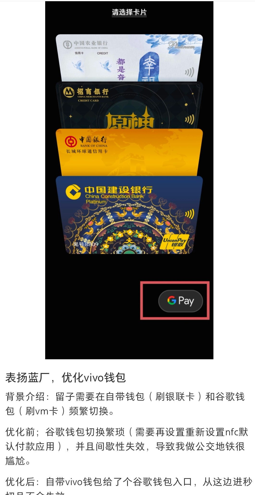

# MiPay GPay LSP

[](https://github.com/MasterOfStar/mipay_gpay_lsp/actions)
[](https://github.com/MasterOfStar/mipay_gpay_lsp/releases)
[](LICENSE)

> LSPosed 模块：在小米智能卡（MiPay）刷卡页面注入 Google Pay 快捷按钮，一键跳转 Google Wallet。
> 本项目全部代码工作由Vibe-coding完成

> **DEV 锁屏唤起**：使用 system_server 侧 QUICKDRAW 处理。LSPosed 作用域勾选 `com.miui.tsmclient`、`android`，不要勾选 Google Wallet。锁屏下会等待 QuickDraw 窗口可见后触发 Wallet 自己请求的真实指纹/密码验证，不会伪造解锁成功；NFC 刷卡仍然需要设备真正解锁。


## ✨ 功能特性

- **无缝集成**：Hook 小米智能卡 `DoubleClickActivity`，在刷卡页面右下角显示 Google Pay 药丸按钮
- **Material Design 3**：默认使用 MD3 风格，自适应系统 Monet 主题色
- **MIUIX 风格**：可在设置页切换，设置页和注入按钮会一起切换
- **一键跳转**：点击按钮直接打开 Google Wallet 刷卡界面，锁屏下也能直接显示
- **轻量可靠**：仅注入必要代码，不影响 MiPay 原有功能
- **模块设置**：支持 MIUIX 风格、双击电源键唤起（需勾选 `System Framework`）、隐藏桌面图标开关

## 📱 系统要求

| 项目 | 要求 |
|------|------|
| 框架 | [LSPosed](https://github.com/LSPosed/LSPosed) |
| Android | 12+ (API 30+) |
| Root | Magisk / KernelSU（锁屏跳转需要） |
| 目标应用 | 小米智能卡 (`com.miui.tsmclient`) |
| 依赖应用 | Google Wallet (`com.google.android.apps.walletnfcrel`) |

## 🚀 安装使用

1. **下载 APK**：从 [Releases](https://github.com/MasterOfStar/mipay_gpay_lsp/releases) 下载最新版本
2. **安装模块**：在 LSPosed Manager 中安装并启用模块
3. **选择目标**：勾选作用域 → `小米智能卡` (`com.miui.tsmclient`) 和 `System Framework` (`android`)
4. **授予 Root**：打开模块界面，允许模块获取 Root 权限
5. **重启应用**：强制停止并重新打开小米智能卡
6. **开始使用**：刷卡时右下角会出现 Google Pay 按钮，点击即可跳转

模块桌面图标默认显示，也可以在桌面直接打开设置页；如果只想保留 LSPosed 隐式入口，可打开“隐藏桌面图标”：

```bash
adb shell am start -a com.mipay.gpay.lsp.SETTINGS
```

设置页中的“隐藏桌面图标”默认关闭，关闭时桌面会显示入口。

## 🖼️ 效果预览

在小米智能卡刷卡页面右下角显示 Google Pay 药丸按钮：

```
┌─────────────────────────────┐
│         Mipay               │
│                             │
│                             │
│                             │
│                    ┌─────┐  │
│                    │ GPay│  │  ← 注入的快捷按钮
│                    └─────┘  │
└─────────────────────────────┘
```

## 💡 灵感来源



## 🛠️ 自行编译

```bash
# 克隆仓库
git clone https://github.com/MasterOfStar/mipay_gpay_lsp.git
cd mipay_gpay_lsp

# 编译 Release APK
./gradlew assembleRelease

# 输出路径
app/build/outputs/apk/release/app-release.apk
```

## 📋 技术细节

- **Hook 目标**：`com.miui.tsmclient.ui.quick.DoubleClickActivity`
- **电源键双击**：在 system_server 消费第二次电源键，并在 `ActivityStarter` 阻断 MiPay 双击页
- **锁屏 QuickDraw**：使用 `FLAG_SHOW_WHEN_LOCKED` 启动，延迟 Wallet 的真实 `dismissKeyguard` 到窗口可见后执行
- **注入方式**：动态添加 FrameLayout + ImageButton
- **SVG 渲染**：使用 [AndroidSVG](https://github.com/BigBadaboom/androidsvg) 渲染 Google Pay Logo
- **主题适配**：读取系统 `system_accent1_100` 色值实现 Monet 动态着色

## 🤝 贡献

欢迎提交 Issue 和 PR！

## 📄 许可证

[MIT License](LICENSE)

---

> 本项目仅供学习交流使用，与小米、Google 无任何关联。
